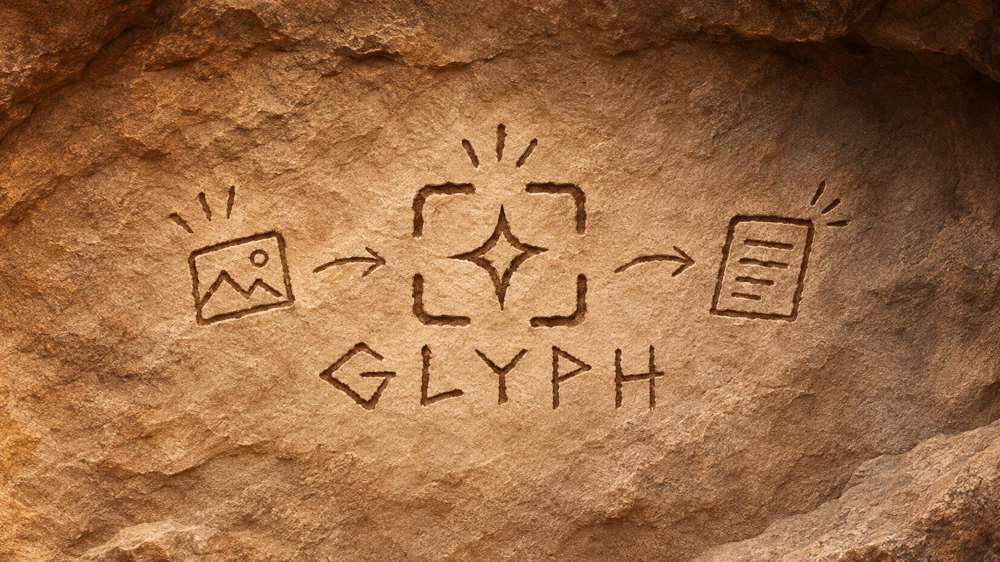

<div align="center">
  
</div>

<h3 align="center">Minimal, high-performance Wayland screen OCR and text extraction tool.</h3>

<p align="center">
  <a href="LICENSE"></a>
  <a href="https://github.com/sid-lakhani/glyph/actions/workflows/ci.yml"></a>
  
  
</p>

---

## Overview

glyph is a lightweight screen text sniper designed specifically for Wayland compositors (Hyprland, Sway, River, and wlroots-based desktop environments). Select any region on screen to extract clean text directly to your system clipboard with a desktop confirmation preview.

Unlike traditional OCR scripts that rely on Python runtimes, heavy Electron shells, or temporary files written to `/tmp`, glyph is compiled to a single native binary with an in-memory processing pipeline.

---

## Features

- **Wayland Native:** Integrates directly with Wayland protocols via `slurp` for region selection and `grim` for pixel acquisition.
- **In-Memory Streaming:** Captured screen buffers are processed and passed directly in memory without intermediate disk I/O.
- **Dual Recognition Engine:** Automatically identifies QR codes via `bardecoder` to extract URLs instantly, or routes text regions through Tesseract OCR.
- **Image Enhancement:** Applies Lanczos3 upscaling to small crops, converts to 8-bit luma grayscale, and stretches dynamic range contrast for accurate character recognition.
- **Smart Text Formatting:**
  - **Prose Mode (Default):** Re-joins hyphenated line wraps (`exam-\nple` to `example`) and merges accidental line breaks within paragraphs.
  - **Code Mode (`--code`):** Preserves leading spaces, tabs, brackets, and structural indentation while normalizing typographic quotes.
  - **Single-Line Mode (`--line`):** Collapses arbitrary multi-line selections into a single space-separated line.
- **Desktop Integration:** Delivers persistent clipboard data via `wl-copy` (with native `arboard` fallback) and presents desktop preview notifications (`notify-rust` with `notify-send` fallback).
- **Graceful Cancellation:** Pressing `Escape` or clicking outside during region selection terminates execution cleanly with exit code `0`.

---

## Installation

### Arch Linux (AUR)

glyph is available in the Arch User Repository:

```bash
# Compile from source
paru -S glyph-ocr
# or
yay -S glyph-ocr

# Precompiled release binary
paru -S glyph-ocr-bin
# or
yay -S glyph-ocr-bin
```

### From GitHub Releases

Pre-compiled binary releases for `x86_64-unknown-linux-gnu` are available on the [Releases](https://github.com/sid-lakhani/glyph/releases) page.

```bash
curl -LO https://github.com/sid-lakhani/glyph/releases/latest/download/glyph-x86_64-unknown-linux-gnu.tar.gz
tar -xzvf glyph-x86_64-unknown-linux-gnu.tar.gz
sudo install -m 755 glyph /usr/local/bin/glyph
```

### From Source

Requires the Rust toolchain (1.75+) and system capture dependencies:

```bash
# Clone the repository
git clone https://github.com/sid-lakhani/glyph.git
cd glyph

# Build and install locally
cargo install --path .
```

To link against system C libraries for Tesseract and Leptonica directly:

```bash
cargo install --path . --features tesseract
```

---

## Usage

### Command-Line Interface

```text
Usage: glyph [OPTIONS]

Options:
  -c, --code            Preserve indentation and code structure (Code Mode)
  -l, --line            Collapse text into a single continuous line (Line Mode)
  -s, --silent          Suppress desktop notifications
      --stdout          Output recognized text directly to stdout (pipe-friendly)
      --lang <LANG>     OCR language code [default: eng]
  -h, --help            Print help
  -V, --version         Print version
```

### Common Commands

```bash
# Capture region and copy formatted prose to clipboard
glyph

# Capture source code preserving leading indentation
glyph --code

# Capture a single continuous line (e.g. URLs, error strings, API tokens)
glyph --line

# Pipe extracted text to another command without triggering notifications
glyph --stdout | jq .

# Perform OCR using a specific language dataset
glyph --lang deu
```

---

## Compositor Integration

### Hyprland

Add keybindings to `~/.config/hypr/hyprland.conf`:

```ini
# Standard text capture (Prose Mode)
bind = Super+Shift, T, exec, glyph

# Code capture (preserves indentation)
bind = Super+Shift+Alt, T, exec, glyph --code

# Single-line capture
bind = Super+Shift, Y, exec, glyph --line
```

### Sway

Add keybindings to `~/.config/sway/config`:

```ini
# Standard text capture
bindsym $mod+Shift+t exec glyph

# Code capture
bindsym $mod+Shift+Mod1+t exec glyph --code
```

---

## Architecture Overview

```text
  +-------------------------+
  |  Region Selection       |
  |  (slurp)                |
  +------------+------------+
               |
               v
  +-------------------------+
  |  Pixel Stream Grab      |
  |  (grim -> in-memory)    |
  +------------+------------+
               |
               v
  +-------------------------+
  |  Image Preprocessing    |
  |  (Lanczos3 / Grayscale) |
  +------------+------------+
               |
        +------+------+
        |             |
        v             v
  +-----------+ +-----------+
  | QR Engine | | Tesseract |
  | (decoder) | | Engine    |
  +-----+-----+ +-----+-----+
        |             |
        +------+------+
               |
               v
  +-------------------------+
  |  Text Post-Processor    |
  |  (Prose / Code / Line)  |
  +------------+------------+
               |
        +------+------+
        |             |
        v             v
  +-----------+ +-----------+
  | Wayland   | | Desktop   |
  | Clipboard | | Toast     |
  +-----------+ +-----------+
```

---

## Contributing

Contributions, bug reports, and suggestions are welcome. Please refer to [CONTRIBUTING.md](CONTRIBUTING.md) for details on the development environment, testing requirements, and pull request guidelines.

---

## License

This project is licensed under the MIT License. See [LICENSE](LICENSE) for details.
